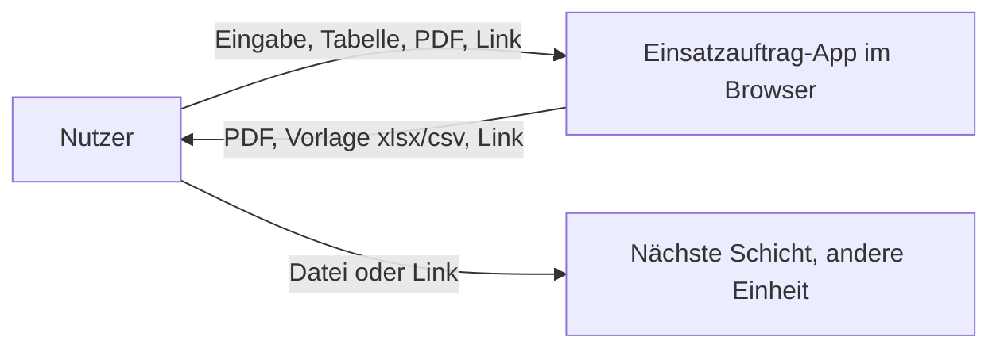
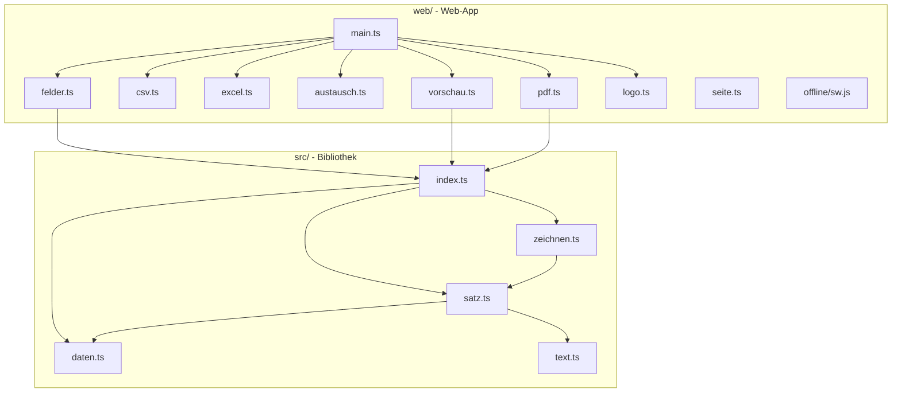
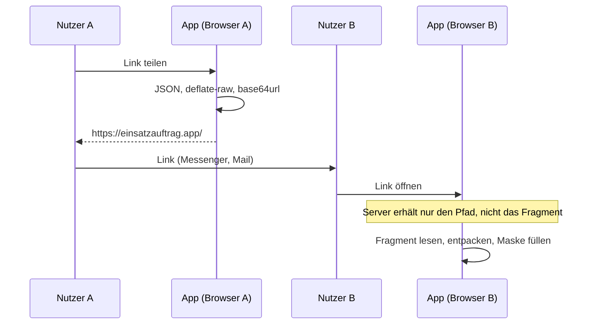
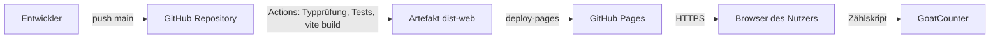

# Einsatzauftrag: Architekturdokumentation nach arc42

Stand: 30.10.2026, Codestand 6f44e34. Die Gliederung folgt arc42 in Version 8. Das Dokument beschreibt, was im Repository steht; Wünsche und Vorhaben stehen nur dort, wo sie ausdrücklich so heißen.

## 1. Einführung und Ziele

Der Einsatzauftrag ist ein Vordruck („Fb Fü 3“) des THW, mit dem eine Führungskraft einer Einheit einen Auftrag schriftlich erteilt: Lage, Auftrag, Durchführung, Logistik, Führung und Verbindung. Das Repository liefert zwei Dinge. Eine TypeScript-Bibliothek setzt den Vordruck mit jsPDF als Vektorgrafik auf DIN A4. Eine Web-App in `web/`, veröffentlicht unter einsatzauftrag.app, füllt ihn über eine Eingabemaske mit Live-Vorschau aus oder erzeugt viele Aufträge auf einmal aus einer Excel- oder CSV-Tabelle.

### 1.1 Aufgabenstellung

| Nr. | Anforderung |
| --- | --- |
| A1 | Einen Auftrag am Bildschirm erfassen und als PDF ausgeben, die dem Papiervordruck entspricht. |
| A2 | Viele Aufträge aus einer Tabelle (Excel, CSV) in einem Durchgang erzeugen. |
| A3 | Auf einer A4-Seite bleiben: Schrift automatisch 10 bis 8 pt, danach Fortsetzungsseiten. Text wird nie abgeschnitten. |
| A4 | Einen Auftrag weitergeben können, ohne abzutippen: PDF wieder einlesen, Auftrag als Link teilen, Auftrag kopieren. |
| A5 | Übungsaufträge unverwechselbar kennzeichnen (Wasserzeichen „ÜBUNG“). |
| A6 | Ohne Netz starten und arbeiten, nachdem die App einmal geladen wurde. |
| A7 | Als Bibliothek in anderen Projekten nutzbar sein (`zeichneEinsatzauftrag`, `setzeEinsatzauftrag`). |

### 1.2 Qualitätsziele

Die drei wichtigsten, in dieser Reihenfolge:

| Rang | Ziel | Bedeutung |
| --- | --- | --- |
| 1 | Datensparsamkeit | Eingaben verlassen das Gerät nicht. Es gibt keinen Server, der Auftragsinhalte sieht. |
| 2 | Verlässlichkeit im Einsatz | Kein Text geht verloren oder wird abgeschnitten. Die App läuft ohne Netz. Gleiche Eingabe ergibt dieselbe PDF. |
| 3 | Treue zum Vordruck | Maße, Beschriftung und Gliederung folgen dem Word-Formular, Ränder nach DIN 5008. |

### 1.3 Stakeholder

| Rolle | Erwartung |
| --- | --- |
| Einsatzkräfte und Führungskräfte (Nutzer) | Schnell und fehlerarm einen druckbaren Auftrag erzeugen, auch am Telefon, auch bei Dunkelheit. |
| Einsetzende Stelle (THW-Ortsverband, Behörde) | Weiß, wo Auftragsdaten liegen; ist für Geräte und erzeugte PDF verantwortlich. |
| Betreiber (Johannes Rudolph) | Geringer Betriebsaufwand, rechtssicherer Betrieb (Impressum, Datenschutz). |
| Entwickler fremder Projekte | Kleine Bibliothek mit stabiler Schnittstelle, ohne Laufzeit-Abhängigkeiten. |

## 2. Randbedingungen

| Art | Randbedingung |
| --- | --- |
| Technisch | TypeScript, ESM für Node, Importe mit `.js`-Endung. `jspdf` ist Peer-Abhängigkeit; die Bibliothek bringt keine Laufzeit-Abhängigkeiten mit. |
| Technisch | Die Web-App ist Anwendung, nicht Bibliothek: Vite, ExcelJS und die Schrift Archivo bleiben devDependencies und gelangen nie nach `dist/`. |
| Technisch | Auslieferung als statische Dateien über GitHub Pages. Es gibt keine Möglichkeit, eigene HTTP-Header zu setzen. |
| Technisch | Browser mit `CompressionStream`, Service Worker und `localStorage`. |
| Organisatorisch | Kein THW-Zeichen im Repository. Logos bringt der Nutzer selbst mit. |
| Organisatorisch | Lizenz EUPL-1.2. Commits nach Conventional Commits. |
| Gestalterisch | Aufbau und Gestaltung folgen `wattnpapa/bos-nachrichtenvordruck`; die Oberfläche folgt dem Design-System von erfassungsbogen.app (Rollen-Token, Radius 0, Anzeigemodi Standard, Dunkel, Feld, Nacht). |
| Rechtlich | Datenschutzerklärung und Impressum sind Teil der App (`web/datenschutz.html`, `web/impressum.html`). Die Datenschutz-Folgenabschätzung liegt in `docs/dsfa.md`. |
| Konvention | Die Zeichenreihenfolge ist festgeschrieben, damit gleiche Eingabe dieselbe PDF ergibt. |

## 3. Kontextabgrenzung

### 3.1 Fachlicher Kontext

Ein Nutzer gibt die Felder des Vordrucks ein oder liefert eine Tabelle. Heraus kommt eine PDF zum Drucken oder Weitergeben. Daneben gibt es drei Wege, einen Auftrag ohne Abtippen weiterzureichen: die in der PDF mitgeführten Daten, einen Link und die Funktion „Auftrag kopieren“.

### 3.2 Technischer Kontext

| Nachbar | Schnittstelle | Was fließt |
| --- | --- | --- |
| GitHub Pages | HTTPS, Abruf statischer Dateien | Seiten, Programmcode, Schrift, Symbole. Dabei fällt die IP-Adresse in Server-Logs an. |
| GoatCounter (`gc.zgo.at`, `einsatzauftrag.goatcounter.com`) | Zählskript, nach dem Laden der Seite eingebunden | Aufgerufene Seite, Titel, Referrer, Bildschirmbreite, Browser, System, Land. Keine Eingaben. |
| Browser-Speicher | `localStorage`, Cache Storage | Einstellungen, Entwurf, Logo, Anzeigemodus; statische Dateien für den Offline-Start. |
| Dateisystem des Nutzers | Datei-Dialog, Download, Drag and drop | PDF, xlsx, csv, Logo. |
| Zwischenablage | `navigator.clipboard` | Link zum Auftrag. |
| Andere Apps der Familie | Verweise im Fuß | Nur Links, kein Datenaustausch. |

Es gibt keine Schnittstelle zu einem Backend, einer Datenbank oder einem Anmeldedienst.

## 4. Lösungsstrategie

| Ziel | Entscheidung |
| --- | --- |
| Datensparsamkeit | Alles läuft im Browser. Kein Server nimmt Auftragsinhalte entgegen. |
| Gleiche Ausgabe in PDF und Vorschau | Der Satz (`src/satz.ts`) rechnet eine Liste einfacher Zeichenelemente je Seite (Fläche, Linie, Text, Bild in mm). `src/zeichnen.ts` zeichnet sie in die PDF, die Vorschau als SVG. Nichts im Satz hängt vom Zeichnen ab. |
| Text geht nie verloren | Der Satz probiert die Schriftgrößen 10, 9,5, 9, 8,5, 8 pt und rückt Abschnitte enger. Reicht das nicht, nimmt er die größte Größe mit der geringsten Seitenzahl und teilt lange Texte zeilenweise auf Fortsetzungsseiten. Nur einzeilige Felder (am, um, von, lfd. Nr.) kürzen mit „…“. |
| Eine Quelle für Maske und Tabelle | `web/src/felder.ts` beschreibt Felder und Spalten einmal; Eingabemaske, Excel-Vorlage und Einlesen leiten sich daraus ab. |
| Weitergabe ohne Server | Feldwerte werden als JSON mit `CompressionStream` (deflate-raw) verdichtet, als base64url kodiert und entweder in die PDF-Metadaten (`Keywords`) oder in das Fragment eines Links (`#a=…`) gelegt. Das Fragment schickt der Browser nicht an den Server. |
| Betrieb ohne Netz | Ein Service Worker legt beim Installieren alle Dateien der Fassung in den Cache. Seiten kommen zuerst aus dem Netz (damit neue Fassungen ankommen), nach drei Sekunden oder bei Fehler aus dem Cache. |
| Gleiche Eingabe, gleiche PDF | Feste Zeichenreihenfolge, keine Zufallswerte im Satz. |
| Wenig Abhängigkeiten | Keine Laufzeit-Abhängigkeiten in der Bibliothek. ExcelJS wird in der App erst beim ersten Excel-Zugriff nachgeladen. |

## 5. Bausteinsicht

### 5.1 Ebene 1: Bibliothek und Web-App

### 5.2 Bibliothek `src/`

| Baustein | Verantwortung |
| --- | --- |
| `daten.ts` | Typ `EinsatzauftragDaten`, die feste Gliederung (Abschnitte 1 bis 5, Unterpunkte 1a bis 4g) in `ABSCHNITTE` und `UNTERPUNKTE`. |
| `text.ts` | Textumbruch für Formularzellen, Kürzen mit „…“, Ersetzen von Zeichen, die die PDF-Standardschrift nicht kennt („→“ wird „->“). Übernommen aus bos-nachrichtenvordruck. |
| `satz.ts` | Rechnet Maße, Schriftgröße und Seitenumbrüche, liefert `Satz` mit Seiten aus Zeichenelementen. Wasserzeichen „ÜBUNG“ und Fußzeile entstehen hier. |
| `zeichnen.ts` | `zeichneSeite` und `zeichneEinsatzauftrag`: übersetzt die Elemente in jsPDF-Aufrufe. |
| `index.ts` | Öffentliche Schnittstelle. |

Öffentliche Schnittstelle: `zeichneEinsatzauftrag(pdf, daten, optionen)` rechnet und zeichnet; `setzeEinsatzauftrag(pdf, daten, optionen)` rechnet nur; `zeichneSeite(pdf, seite)` zeichnet eine Seite. Optionen: `kennung`, `titel`, `organisation`, `logo`, `schriftgroesse`, `fusszeile`.

### 5.3 Web-App `web/`

| Baustein | Verantwortung |
| --- | --- |
| `main.ts` | Verdrahtung: baut die Eingabemaske, verwaltet Entwurf, Einstellungen und Logo im `localStorage`, nimmt Dateien an, zeigt Vorschau und Fehlermeldungen, registriert den Service Worker. |
| `felder.ts` | Felder und Spalten, Beispieldaten, Umwandlung `Werte` zu `EinsatzauftragDaten`. |
| `csv.ts`, `excel.ts` | Einlesen und Schreiben von Tabellen. Erkennt Trennzeichen und Kodierung, liest Spaltenköpfe auch unter Alternativnamen. Excel über ExcelJS, nachgeladen. |
| `austausch.ts` | Kodieren und Dekodieren der Feldwerte (JSON, deflate-raw, base64url), Fassungskennung `einsatzauftrag:v1:`, Obergrenze von 4 MiB für den entpackten Inhalt. |
| `pdf.ts` | Setzt alle Aufträge in eine PDF, trägt die kodierten Werte in `Keywords` ein, vergibt Dateinamen. |
| `vorschau.ts` | Zeichnet die Seiten des Satzes als SVG. |
| `logo.ts` | Liest ein Bild, verkleinert auf höchstens 600 Pixel Kantenlänge, wandelt in PNG. |
| `seite.ts` | Anzeigemodus, Widerspruch gegen die Reichweitenmessung (`skipgc`), gemeinsam für App und Rechtsseiten. |
| `offline/sw.js` | Vorlage des Service Workers; `vite.config.ts` setzt beim Bauen Version, Fassung und Dateiliste ein. |
| `index.html`, `datenschutz.html`, `impressum.html` | Die drei Seiten der App. |

### 5.4 Ebene 2: Satz (`satz.ts`)

Der Satz arbeitet in drei Schritten. Zuerst legt er die Zeilen jedes Abschnitts mit ihren umbrochenen Texten an, für eine gewählte Schriftgröße. Dann prüft er, ob alles auf eine Seite passt, und verringert andernfalls Größe und Abstände. Zuletzt verteilt er bei Bedarf Zeilen auf Fortsetzungsseiten und ergänzt Kopf, Kopfzeile „(Fortsetzung)“ und Fußzeile mit lfd. Nr. und „Seite x von y“. In Abschnitt 5 beginnt in einem Text eine Leerzeile eine neue Formularzeile; als Liste ist jeder Eintrag eine Zeile.

## 6. Laufzeitsicht

### 6.1 Einzelnen Auftrag erzeugen

1. Der Nutzer tippt in die Maske. `main.ts` sichert den Entwurf im `localStorage` und ruft den Satz auf.
2. `vorschau.ts` zeichnet die Seiten als SVG neben die Maske.
3. Beim Klick auf „PDF herunterladen“ ruft `pdf.ts` zuerst `kodiereWerte`, legt dann eine `jsPDF`-Instanz an, setzt die Metadaten und ruft `zeichneEinsatzauftrag`.
4. Der Browser lädt die Datei herunter, Dateiname `einsatzauftrag_nr<Nr>_<Datum>_<Zeit>.pdf`.

### 6.2 Aufträge aus einer Tabelle

1. Der Nutzer wählt eine xlsx- oder csv-Datei. Bei xlsx lädt die App ExcelJS nach (aus dem Cache, wenn offline).
2. `csv.ts` oder `excel.ts` liefern eine Zeilenliste, `felder.ts` ordnet Spalten Feldern zu und sammelt Hinweise zu unbekannten oder doppelten Spalten.
3. Jede Zeile wird ein Auftrag; `pdf.ts` setzt alle in eine PDF, jeder beginnt auf einer neuen Seite.

### 6.3 Auftrag weitergeben

Beim Wiedereinlesen einer PDF liest die App den Eintrag `Keywords`, prüft die Kennung `einsatzauftrag:vN:`, entpackt mit Obergrenze und füllt Maske oder Tabellenansicht. Eine neuere Fassung als bekannt lehnt sie mit Hinweis ab.

### 6.4 Start ohne Netz

Beim ersten Aufruf legt der Service Worker alle Dateien der Fassung unter `ea-<Version>` ab. Erst wenn alle drin sind, setzt er die Marke `__vollstaendig__`. Spätere Seitenaufrufe gehen zuerst ans Netz (`cache: "no-cache"`), nach 3 Sekunden oder bei Fehlerantwort kommt die gespeicherte Seite. Programmteile mit Inhalts-Hash im Namen kommen aus dem Cache. Die vorige vollständige Fassung bleibt erhalten, damit ein noch offener Tab seine nachgeladenen Teile findet.

## 7. Verteilungssicht

| Umgebung | Beschreibung |
| --- | --- |
| Entwicklung | `npm run web` (Vite-Entwicklungsserver), `npm test`. |
| CI | `.github/workflows/ci.yml`: Typprüfung, Vitest mit Abdeckung (Schwellen: Zeilen und Anweisungen 90 %, Funktionen 90 %, Zweige 85 %, nur `src/`), Bibliothek bauen, Web-App bauen. Node 22. |
| Betrieb | `.github/workflows/pages.yml` baut bei jedem Push auf `main` und veröffentlicht über GitHub Pages unter einsatzauftrag.app; die App nutzt relative Pfade und läuft ebenso unter `wattnpapa.github.io/einsatzauftrag/`. |
| Bibliothek | Installation per `npm install jspdf github:wattnpapa/einsatzauftrag`; `prepare` baut nach `dist/`. |

Die Fassung (Bauzeit in UTC und Commit) steht im Fuß der App und im Service Worker. Zwei Auslieferungen am selben Tag lassen sich so unterscheiden.

## 8. Querschnittliche Konzepte

### 8.1 Datenhaltung im Browser

| Schlüssel | Inhalt |
| --- | --- |
| `ea.entwurf.v1` | Eingaben der Maske samt Zeitpunkt der letzten Änderung; wird beim Start gelöscht, wenn älter als die Frist (24 Stunden, wählbar 7 Tage oder gar nicht gespeichert) |
| `ea.einstellungen.v1` | Kennung, Organisation, Schriftwahl, Frist des Entwurfs |
| `ea.logo.v1` | Selbst gewähltes Logo als PNG-Datenadresse |
| `ea.anzeigemodus.v1` | Standard, Dunkel, Feld oder Nacht |
| `ea.vorschau.v1` | Vorschau ein- oder ausgeblendet |
| `skipgc` | Widerspruch gegen die Reichweitenmessung |

Jeder Zugriff ist durch try/catch geschützt; die App läuft auch, wenn der Browser den Speicher verweigert. Eingelesene Tabellen werden nicht gespeichert. Der Cache Storage enthält nur statische Dateien.

### 8.2 Anzeigemodi

Vier Modi (Standard, Dunkel, Feld, Nacht) über Rollen-Token in `web/src/stil.css`. Ein kleines Skript im Kopf jeder Seite setzt den Modus vor dem ersten Malen, damit es nachts nicht hell aufblitzt. Ohne gespeicherte Wahl entscheidet die Systemeinstellung.

### 8.3 Fehlerbehandlung

Einlesefehler (beschädigte Daten, falsches Dateiformat, nicht lesbares Bild) werden als verständliche Meldung angezeigt, die Eingabe bleibt unverändert. Der Entpacker bricht oberhalb von 4 MiB ab, damit ein präparierter Link den Browser nicht flutet. Beim Einlesen von Tabellen sammelt die App Hinweise (unbekannte, doppelte, fehlende Spalten) und zeigt sie an, statt abzubrechen.

### 8.4 Schutz vor Verwechslung

Mit `uebung: true` trägt jede Seite quer das hellrote Wasserzeichen „ÜBUNG“ hinter dem Formular, und die Fußzeile nennt es. Die Herkunftszeile „Erstellt mit einsatzauftrag.app“ steht am Blattrand jedes Auftrags der App.

### 8.5 Datenschutz und Sicherheit

Die Verarbeitung von Auftragsinhalten bleibt auf dem Gerät. Offen bleibt, was der Nutzer selbst weitergibt: Die PDF trägt ihre Eingaben maschinenlesbar in den Metadaten, ein geteilter Link enthält sie vollständig. Die Bewertung steht in `docs/dsfa.md`. Technisch gilt:

- Es gibt keine Cookies.
- Das einzige nachgeladene Skript fremder Herkunft ist `gc.zgo.at/count.js`. Es läuft im Kontext der Seite und könnte deren Inhalt lesen; das ist als Risiko in der DSFA geführt.
- Jede Seite trägt eine Content Security Policy als `<meta>`, weil GitHub Pages keine eigenen Header erlaubt. `vite.config.ts` (Plugin `sicherheit`) setzt sie beim Bauen ein und gibt die kurzen Inline-Skripte und das Inline-Stylesheet über ihren SHA-256-Hash frei. Fremde Skripte sind nur von `gc.zgo.at` erlaubt, Verbindungen nur zur eigenen Herkunft und zu `einsatzauftrag.goatcounter.com`. `frame-ancestors` lässt sich per `<meta>` nicht setzen. Im Entwicklungsserver gilt die Policy nicht.
- Eingaben werden nie als HTML eingefügt, sondern über `textContent`; die Vorschau baut SVG-Elemente aus Zeichenelementen.

### 8.6 Tests

Vitest prüft Satz und Textumbruch in `tests/`, die Hilfen der App (Felder, CSV, Excel, Austausch, PDF) in `tests/web/`. Die Abdeckungsschwellen gelten für `src/`. `main.ts`, die Oberfläche und der Service Worker sind nicht automatisiert getestet.

### 8.7 Reproduzierbarkeit

Der Satz verwendet keine Zufalls- oder Zeitwerte. Die Zeichenreihenfolge ist festgeschrieben. Gleich sind damit die Zeichenbefehle. Ob zwei Dateien auch byteweise gleich sind, hängt vom Erstellungsdatum ab, das jsPDF in die Metadaten schreibt; der Code setzt es nicht selbst und ein Test dafür fehlt.

## 9. Architekturentscheidungen

| Nr. | Entscheidung | Begründung | Folge |
| --- | --- | --- | --- |
| E1 | Formular als Vektorgrafik zeichnen statt Word-Vorlage zu füllen | Keine Vorlage zum Mitliefern, volle Kontrolle über Zeilenhöhen und Seitenumbruch | Maße sind am Word-Formular abgenommen und müssen bei Änderung des Vordrucks nachgezogen werden. |
| E2 | Satz getrennt vom Zeichnen | Vorschau und PDF zeigen dasselbe, Satz ist ohne PDF testbar | Zeichenelemente bilden eine stabile innere Schnittstelle. |
| E3 | Kein Server | Datensparsamkeit, kein Betriebsaufwand, Betrieb ohne Netz | Keine gemeinsame Ablage, kein Konto; Weitergabe nur über Datei oder Link. |
| E4 | Daten im Fragment des Links und in den PDF-Metadaten | Weitergabe ohne Server und ohne Abtippen | Wer die Datei oder den Link hat, hat die Daten. Eine neu gedruckte oder zusammengeführte PDF verliert sie meist. |
| E5 | Eigene Kompression mit `CompressionStream` | Keine zusätzliche Abhängigkeit | Setzt einen aktuellen Browser voraus. |
| E6 | `jspdf` als Peer-Abhängigkeit | Nutzer der Bibliothek behalten die Version in der Hand | Version `^4.0.0` ist festgelegt. |
| E7 | Service Worker mit Netz zuerst, 3 Sekunden Wartezeit | Neue Fassungen sollen ankommen, schwaches Netz darf die App nicht blockieren | Aufwendigere Logik in `sw.js`, nicht automatisiert getestet. |
| E8 | GoatCounter für Reichweitenmessung | Keine Cookies, keine geräteübergreifende Kennung, Widerspruch möglich | Fremdskript im Seitenkontext; siehe Risiken. |
| E9 | Eigene Gestaltung nach erfassungsbogen.app | Einheitliche Bedienung in der App-Familie | Änderungen am Design-System sind nachzuziehen. |

## 10. Qualitätsanforderungen

### 10.1 Qualitätsbaum

Datensparsamkeit, Verlässlichkeit und Treue zum Vordruck stehen oben (Abschnitt 1.2). Darunter:

- Bedienbarkeit: am Telefon, im Dunkeln, mit Handschuhen. Vorschau am Telefon ausblendbar; vier Anzeigemodi.
- Wartbarkeit: eine Feldliste für Maske und Tabelle; wenige, kleine Module; strenge Typprüfung.
- Portabilität: Bibliothek in Node und Browser lauffähig.

### 10.2 Qualitätsszenarien

| Nr. | Szenario | Erwartung |
| --- | --- | --- |
| Q1 | Ein Auftrag mit sehr langem Text in Abschnitt 3b wird ausgegeben. | Kein Zeichen fehlt; die PDF hat Fortsetzungsseiten mit Kopf und „Seite x von y“. |
| Q2 | Das Netz fällt nach dem ersten Aufruf aus, die Seite wird neu geladen. | Die App startet aus dem Cache und erzeugt PDF. |
| Q3 | Ein Link mit manipuliertem Fragment wird geöffnet. | Die App bricht oberhalb von 4 MiB entpackter Größe ab und meldet beschädigte Daten; die Maske bleibt unverändert. |
| Q4 | Dieselbe Eingabe wird zweimal gesetzt. | Die Zeichenelemente sind gleich. |
| Q5 | Ein Übungsauftrag wird ausgedruckt. | Jede Seite trägt das Wasserzeichen „ÜBUNG“ und die Fußzeile nennt es. |
| Q6 | Ein Nutzer widerspricht der Reichweitenmessung. | Auf diesem Gerät sendet die Seite danach keinen Zählimpuls. |
| Q7 | Eine Excel-Tabelle hat vertauschte oder unbekannte Spalten. | Bekannte Spalten werden zugeordnet, die anderen als Hinweis gemeldet. |

## 11. Risiken und technische Schulden

| Nr. | Punkt | Auswirkung | Maßnahme |
| --- | --- | --- | --- |
| R1 | Zählskript von `gc.zgo.at` läuft im Seitenkontext und hat Zugriff auf Eingaben. | Ein kompromittiertes Skript könnte Auftragsinhalte lesen. Die CSP verhindert nur das Senden an andere Ziele als GoatCounter, nicht das Lesen. | Zählskript selbst ausliefern (Version festhalten) oder Messung abschalten (offen, DSFA M2). |
| R2 | Ohne `frame-ancestors` und ohne eigene Header kann die Seite eingebettet werden. | Clickjacking auf die Maske. | Im Browser-Skript prüfen, ob `window.top` gleich `window` ist, oder anderen Host mit Headern wählen. |
| R3 | Entwurf bleibt bis zur Frist unverschlüsselt im `localStorage`. | Auf gemeinsam genutzten Geräten lesbar. | Frist 24 Stunden, wählbar; Hinweis in der Datenschutzerklärung. Verschlüsselung wäre ohne Schlüsselverwaltung wirkungslos. |
| R4 | Link und PDF enthalten alle Eingaben lesbar. | Weitergabe über Messenger oder Mail fügt einen Dritten hinzu. | Hinweise neben der Funktion und in der Meldung nach dem Kopieren sind da; Abschalten der Funktion für die einsetzende Stelle offen (DSFA M4). |
| R5 | `main.ts` hat rund 900 Zeilen und keine automatischen Tests. | Regressionen in der Oberfläche fallen spät auf. | Browsertests mit Playwright für die Hauptwege (Maske, PDF, Tabelle, Link). |
| R6 | Service Worker ist nicht automatisiert getestet. | Fehler zeigen sich erst im Betrieb. | Test der Cache-Logik mit einem Browsertest. |
| R7 | Maße sind an einem Bild des Word-Formulars abgenommen. | Abweichungen bei Änderung des Vordrucks. | Vordruck und Maße bei jeder neuen Fassung des Fb Fü 3 vergleichen. |
| R8 | Betrieb hängt an GitHub Pages und einem Domainanbieter. | Ausfall oder Sperrung macht die App unerreichbar, installierte Fassungen laufen weiter. | Bibliothek und App sind quelloffen; Spiegel möglich. |

## 12. Glossar

| Begriff | Bedeutung |
| --- | --- |
| Fb Fü 3 | Bezeichnung des Vordrucks Einsatzauftrag beim THW |
| lfd. Nr. | Laufende Nummer des Auftrags |
| Satz | Berechnete Seitenaufteilung als Liste von Zeichenelementen |
| Zeichenelement | Fläche, Linie, Text oder Bild mit Maßen in mm |
| Fragment | Teil einer Adresse hinter „#“; wird vom Browser nicht an den Server geschickt |
| Entwurf | Zwischenstand der Maske im `localStorage` |
| Service Worker | Browser-Skript, das Anfragen abfängt und Dateien für den Betrieb ohne Netz vorhält |
| GoatCounter | Dienst zur Reichweitenmessung ohne Cookies |
| DSFA | Datenschutz-Folgenabschätzung nach Art. 35 DSGVO |
| EUPL-1.2 | European Union Public Licence, Lizenz des Projekts |
